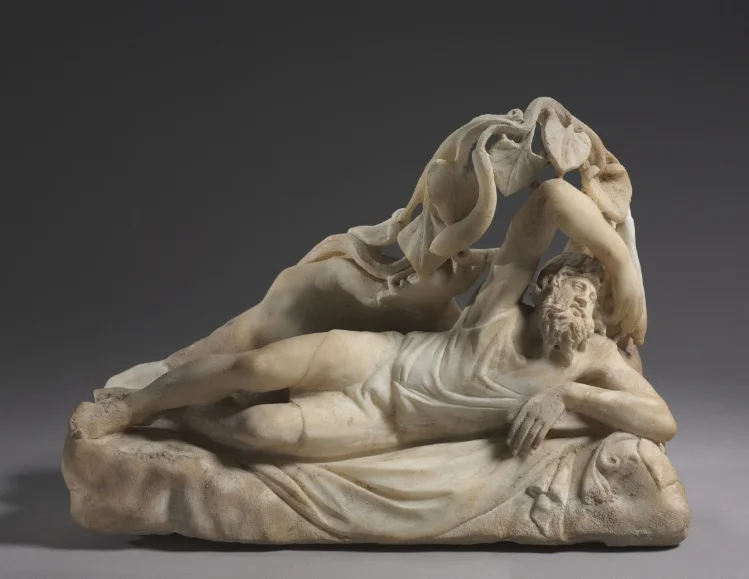
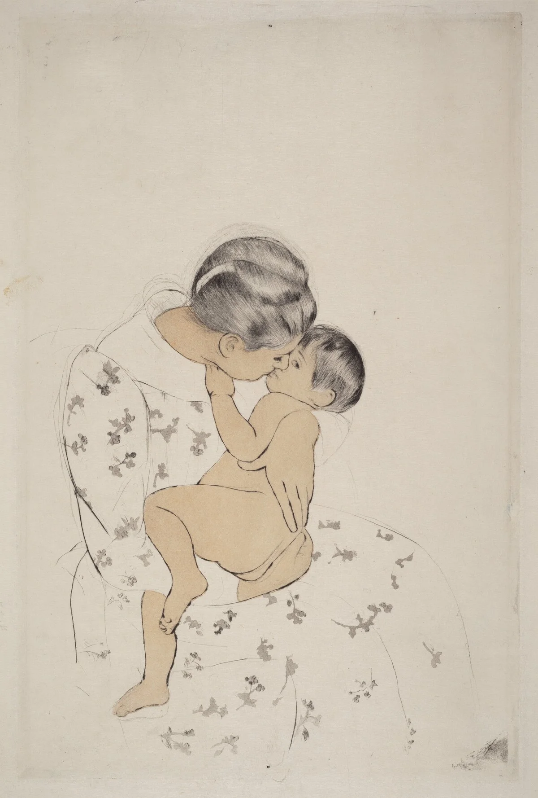
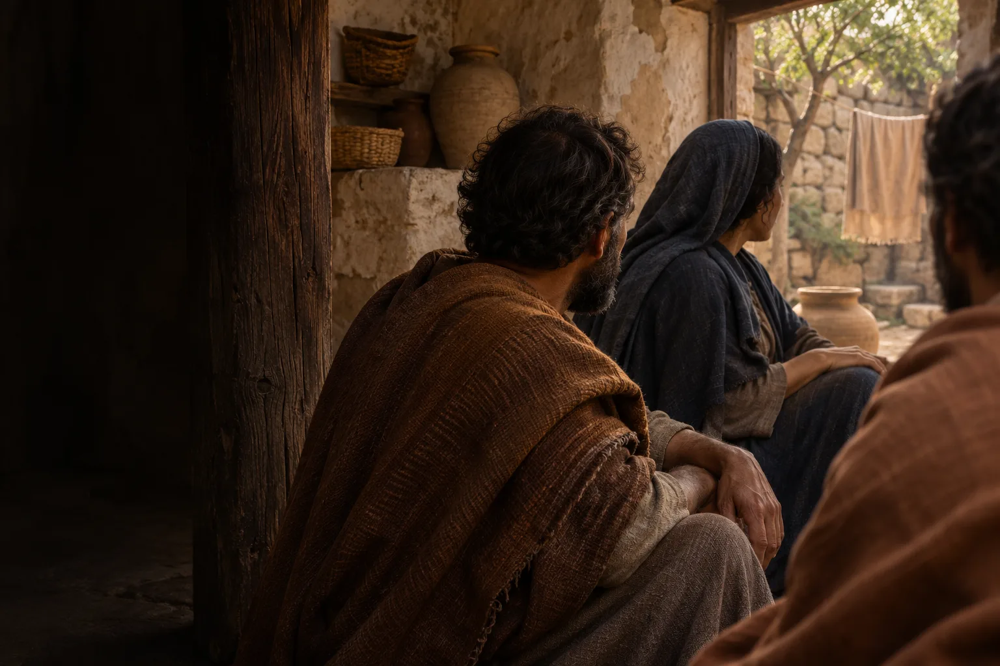
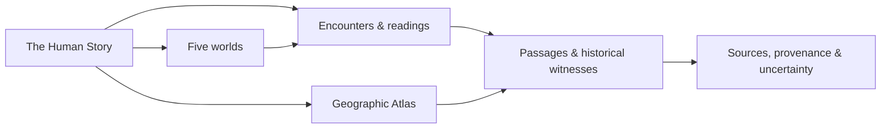
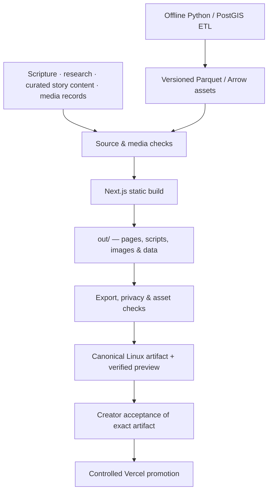

# BibleMap — The Human Story

**Scripture. Lives. A connected world.**

> An ancient story opens onto a city. A city leads to a life. A life leaves a question for someone centuries later.

BibleMap is an immersive exploration of **the human story through a biblical worldview**. Begin with a person, a place, or a passage. Follow the relationships between Scripture, historical witnesses, geography, art, and the people who carried these accounts forward.

The aim is not to turn the past into a spectacle or pretend every question has an answer. It is to make the encounter human—and let the surviving sources speak for themselves.



*Jonah Under the Gourd Vine, c. 280–290 CE. Later Christian art, not a portrait of the biblical Jonah. [Cleveland Museum of Art, 1965.239](https://www.clevelandart.org/art/1965.239) · CC0.*

[Explore BibleMap](https://biblemap-pink.vercel.app/) · [Begin with Jonah](https://biblemap-pink.vercel.app/jonah/) · [Explore the Human Story in code](src/features/human-story/HumanStoryHome.tsx)

> **Soft-launch status:** The public URL can serve an earlier promoted build than this repository's `main` branch. Experiences described below reflect the source tree; availability on the public site and release authorization are separate questions.

## Begin with a life

A single life can be approached through different kinds of evidence. Some words survive in Scripture. Others reach us through letters, historians, Christian memory, or art made centuries later.

| Encounter | The question at its center |
| --- | --- |
| [Jonah](https://biblemap-pink.vercel.app/jonah/) | A prophet, a city, mercy—and an ending that remains a question. |
| [Perpetua](src/features/human-story/PerpetuaEncounter.tsx) | A mother and prisoner in Carthage. Whose voice survives in the *Passion*? |
| [Romanus](src/features/human-story/romanus/RomanusEncounter.tsx) | A man in Antioch. Why do the accounts differ about his voice? |
| [James](src/features/human-story/james/JamesEncounter.tsx) | Jesus's brother, remembered by Paul, Josephus, and later Christians. |
| [Thomas](src/features/human-story/thomas/) | Absence, testimony, encounter, and confession in John 20:24–29. |

Thomas also has a **separate** exploration of sayings and manuscript witnesses attributed to Thomas. That collection is not the Gospel of John, and attribution does not prove apostolic authorship.

| A life seen through later art | An imagined setting, clearly marked |
| --- | --- |
|  |  |
| *Mary Cassatt, Mother’s Kiss (1890–1891). An artistic parallel to Perpetua's account, not her likeness.* | *BibleMap original AI-generated interpretive environment. Invented people and space—not an eyewitness image or a reconstruction of John 20.* |

### Five ways into the same world

**Stories** trace Scripture. **Witnesses** examine records outside the biblical narrative. **Saints** follow lives of faith and the accounts left behind. **Atlas** locates places and movements. **Voices** gather readers, interpreters, theologians, and artists.

These are different entrances, not five disconnected applications.



## The system beneath the experience

BibleMap is built as a **static-first web application**. The stories remain readable without a running production database or a live AI service. Interactive geography adds another layer; it does not replace the text.

| Layer | What it does |
| --- | --- |
| **Next.js App Router · React · TypeScript** | Routes, cinematic encounters, accessible reading modes, and responsive UI. |
| **Typed story content & source records** | Connect Scripture, people, places, and witnesses while keeping evidence and interpretation distinct. |
| **deck.gl · MapLibre** | Interactive maps and time/place exploration in the Atlas, isolated from editorial reading pages. |
| **Python · PostgreSQL/PostGIS · Parquet/Arrow** | Offline geographic/data preparation and versioned files used by the static Atlas; no production database needed for the exported site. |
| **Validation & release tooling** | Pinned-text checks, media provenance, visitor-export boundaries, repeatable artifacts, and creator-controlled publication. |

### How the pieces reach a visitor



The canonical pipeline separates **a successful build**, **a verified preview**, and **permission to publish**. None automatically grants the next. See [release implementation](scripts/release/build.mjs), [preview verification](scripts/release/preview.mjs), and [publication scope](docs/release/publication-scope.json).

## Building BibleMap in public

BibleMap is also the foundation of a development series about the engineering behind an immersive, source-conscious product:

- **Experience design:** translating a human narrative into readable, responsive, cinematic interaction.
- **Systems & data:** building a connected story model and a geospatial Atlas without making the runtime dependent on a database.
- **AI-assisted work:** using agents and generated media while keeping provenance, evaluation, and human editorial judgment visible.
- **Reliability & release:** static-export testing, accessibility, artifact identity, and controlled deployment.

The code, decisions, failures, and improvements matter as much to this series as the finished screens.

## Run locally

CI uses Node.js **22.22.3**; install dependencies from the committed lockfile.

```bash
npm ci
npm run dev         # local Next.js development
npm run build       # checked static export to out/
npm run preview     # serve the exported site
```

Useful checks: `npm run lint`, `npm run typecheck`, `npm test`, `npm run test:e2e`, and `npm run validate:release`. A green build is **not** release approval. See [AGENTS.md](AGENTS.md) for engineering conventions and [experience principles](docs/experience-principles.md) for the editorial approach.

## What is evidence—and what is art?

Scripture, historical reporting, later tradition, scholarly inference, and artistic reconstruction are not interchangeable. BibleMap labels those differences, identifies source limits, and keeps the original text available beside interpretation.

The experience is evolving. Some readings remain provisional; Exodus is unfinished. Generated environments are illustrative, not photographs of biblical events. Editorial review and exact-artifact publication acceptance remain separate from technical verification.

Start with the [Human Story source records](docs/research/human-story-sources.md), [Thomas source dossier](docs/research/thomas-source-dossier.md), and [media manifest](public/media/thomas/manifest.json).

**License and reuse:** [LICENSE](LICENSE) covers repository software as specified there; Scripture, historical data, images, and third-party media retain their own attribution and reuse terms.
