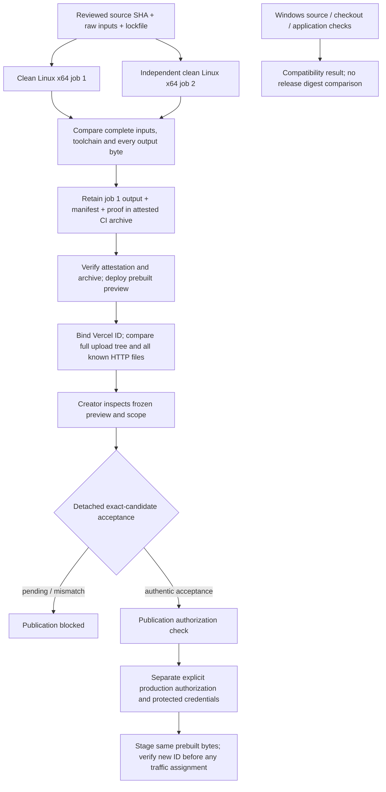

# Canonical Linux release pipeline

This replaces cross-OS artifact equality with one Linux release identity. It
does not approve the Human Story candidate or authorize production publication.
PR #46 remains evidence for its older candidate; its acceptance is not transferred.



## Build and identity

`canonical-release.yml` runs two separate jobs on Ubuntu 24.04, inside the
architecture-specific official Node image pinned in `scripts/release/policy.json`.
Node is 22.22.3 and npm is exactly 10.9.8. Actions are pinned to commit IDs.
`npm ci --include=dev` installs the committed lockfile independently, without a
restored build/dependency cache. Generated output is removed before either build.
The host kernel is managed by GitHub and is outside the container digest; it is
not claimed immutable. The compiler/userspace and dependency bytes are recorded.

Raw SHA-256/length manifests cover **all tracked files**, including ancillary
artifacts/docs used by validators, and **all installed dependency files** (with
contained dependency symlinks recorded). They are not just a Git SHA or normalized
source-text hash. The only detached inputs are the old decision, the new
`canonical-acceptance.json`, and historical records under `docs/release/acceptances/`.
None is imported into application output. Any other tracked edit invalidates the
input identity, even if it happens to leave emitted bytes unchanged.

The existing legacy content digest remains the build-ID mechanism, not the release
identity. Fonts and OFL licenses are vendored from the exact official revision in
`src/app/fonts/provenance.json`; compilation has no Google Fonts fetch. Compiler
environment is an enumerated nonsecret map; Vercel system variables, feedback IDs,
local dotenv files and arbitrary NEXT_PUBLIC variables are absent. Registry inputs
are lockfile-integrity checked and their complete resolved bytes are recorded.
No external content is fetched by the build/ETL steps. Runtime map services retain
their existing behavior and are not new build inputs.

The complete sorted static manifest uses `{path,bytes,checksum}` for every regular
file, including hidden files, RSC, fonts, media, Parquet and WASM. The aggregate
retains `export-inventory.mjs`'s exact JSON encoding. Bytes are never normalized.
Symlinks/special files in the export fail closed. A second complete manifest covers
the entire Build Output API package, including `config.json`. The release manifest
and timestamps stay outside the package and served tree, avoiding recursive hashing.
Build time is metadata, excluded from static/output digests; manifest identity also
binds that particular CI build/run/attempt/replica. Rebuilds require fresh acceptance.

The signed `canonical-release.tgz` CI artifact contains one output, its full input
and output manifests, validator reports, and independent-build comparison proof.
It is immutable for that upload (90-day retention; archive it in protected release
storage before expiry). CI artifact access follows repository permissions; nothing
here changes repository visibility. No secret/env files or large duplicate snapshots
are committed. Fork builds receive no deployment credentials or attestation rights.

## Static hosting and verification boundary

The [Build Output API configuration](https://vercel.com/docs/build-output-api/configuration)
supports static files and explicit routes. `pack.mjs` copies `out/` byte-for-byte to
`.vercel/output/static` and emits reviewed routing configuration. It rejects new
unmapped Vercel configuration instead of dropping it. Existing canonical URLs,
trailing slashes, clean HTML redirects, real 404s and all Linux static RSC paths
are retained. No functions, middleware, wildcard domains or runtime env are added.
The frozen candidate stays noindex with an empty sitemap after acceptance. Any
future indexing change is a new candidate, not an approval side effect.

[Prebuilt deployment](https://vercel.com/docs/cli/deploy) uploads the package without
a second build. Missing system build variables are intentional here: canonical
origin is fixed in source, no system deployment URL is required, review flags are
absent, and output has frozen noindex behavior. No project settings are silently
changed. Next.js Skew Protection/server execution is not used by this static host.

`preview.mjs deploy` first verifies the GitHub attestation against the exact source
and workflow SHA and compares the signed archive to the extracted local output.
It checks the existing team/project and only creates a preview. It then records:

1. Complete local static and package SHA-256 verification.
2. Authenticated Vercel deployment ID, READY preview target and package metadata.
3. [Complete prebuilt upload file tree](https://vercel.com/docs/rest-api/deployments/list-deployment-files),
   matching every provider path and SHA1 identifier with local upload bytes. The
   observed API wraps paths in `src/` and omits lengths; lengths are checked when
   present, and complete local/HTTP verification independently checks byte lengths.
4. HTTP SHA-256 of **every known static file**, including HTML (via its route), JS,
   CSS, fonts, media and RSC, plus redirect/404/prohibited-route assertions.

The packaged `client-config.json` is also hashed. It selects static hosting for this
deployment and prevents source-build `cleanUrls`/routes from being applied a second
time over the package's complete low-level routes. It does not edit project settings.
It also sets the documented `VERCEL_PREVIEW_FEEDBACK_ENABLED=0` for this deployment's
build/runtime environment. The pilot proved that Vercel otherwise appends a 288-byte
deployment-specific toolbar script to the served webpack runtime even when the
uploaded file is unchanged. The [per-deployment override](https://vercel.com/docs/vercel-toolbar/managing-toolbar)
prevents that mutation without changing project-wide settings or deployment protection.

The provider's source/upload tree is not an independent enumeration of the internal
CDN filesystem. SHA1 is Vercel upload identity, not the canonical integrity digest.
Unknown platform-generated metadata is not claimed byte-verified. Vercel's prebuilt
upload/deployment semantics and authenticated deployment identity are the explicit
provider trust boundary. Transport compression may change wire encoding; decoded
content bytes must match exactly. Any unexplained addition, removal or mutation in
an exposed complete upload tree or known served file fails verification. If the API
does not expose a usable tree, verification stays blocked; do not silently downgrade.

## Operator and creator procedure

Use reviewed source, not arbitrary PR code, when authenticating. This workflow has
no Vercel secrets and does not grant them to untrusted builds. Download the successful
**push** run's `canonical-release-<attempt>` artifact with `gh run download`, verify
its attestation, and extract it in the isolated worktree at that source SHA. Retain
`canonical-release.tgz` beside the extraction. The preview tool rechecks provenance:

```text
gh attestation verify canonical-release.tgz --repo jayjz/biblemap --signer-workflow jayjz/biblemap/.github/workflows/canonical-release.yml --source-digest <SHA> --signer-digest <SHA> --deny-self-hosted-runners
tar -xzf canonical-release.tgz
npm run release:preview -- deploy
```

Set `VERCEL_CLI_ENTRY` to the installed Vercel **65.2.0** Node entry point; use existing
authenticated CLI credentials or a protected environment token, never token arguments.
No `vercel build`, redeploy, promote, production flag or alias command is part of the
preview tool. Re-running without `deploy` re-verifies the saved deployment ID. Keep
the detached deployment and verification JSON in protected release evidence storage.

After technical verification, the human creator must inspect the exact preview and
the full publication scope/limitations/rights evidence. They must supply an authentic
acceptance record in `docs/release/canonical-acceptance.json` with these fields:

```text
schemaVersion: 2; status: accepted
actor; decidedAt (UTC); evidence (auditable authentic creator statement)
sourceCommit; sourceInputDigest; artifactDigest; outputDigest
manifestDigest; scopeDigest; previewDeploymentId; verificationDigest
build: { repository, workflow, runId, runAttempt, replica }
routes: exact selected routes; acceptedLimitations: all applicable limitation IDs
```

Copy identities from the verified evidence, never from an unrelated preview. Preserve
previous records under `docs/release/acceptances/` and their authentic evidence. The
agent must not fill actor/date/evidence/status on the creator's behalf. A decision-only
commit does not build, change SEO, rename files or replace the approved artifact.
The canonical workflow ignores changes confined to those detached decision/history
paths. Technical/Windows compatibility checks may still run independently.
`npm run validate:release` checks the detached package and acceptance in that checkout,
then re-verifies the authenticated deployment and all served bytes live. Rechecks
write a separate receipt, preserving the original evidence bound to acceptance;
missing evidence, changed inputs/scope, different build or deployment fail closed.
The approval metadata alone does not cryptographically authenticate an actor; creator
identity and explicit publication authority require review/protected credentials.

**Production remains manual and blocked.** Acceptance is not permission to promote
an arbitrary preview. A later explicit creator production instruction must identify
the accepted manifest and authorize staging the same attested prebuilt package with
production credentials and no domain assignment. Verify that new deployment's upload
identity/HTTP bytes and record its ID before separately authorized traffic assignment.
Do not promote a preview through a path that may rebuild it with production env.
No production writer/credential workflow is installed here; configuring protected
production reviewers/secrets or changing Git automatic-publication settings requires
the owner's explicit authorization. Existing direct production builds now always fail,
even with a legacy acceptance. Repository controls cannot stop someone bypassing them
with owner-level Vercel credentials; retain that external authorization boundary.

Windows CI still tests publisher bytes/LF checkout, pinned sources, source tests,
lint, types and an application build. Its artifact digest never participates in
canonical release authorization. Existing adversarial export, media/license, source,
SEO and desktop/mobile browser suites remain enabled in the technical workflow.
